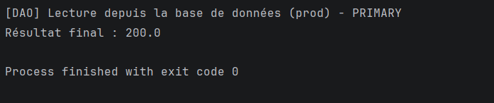
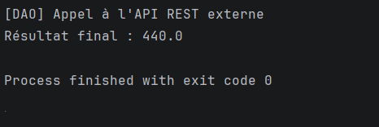
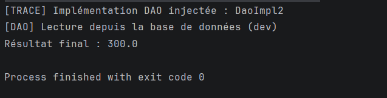
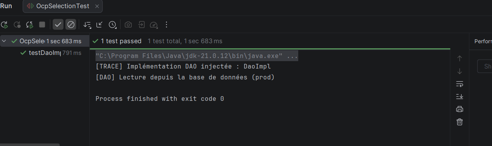
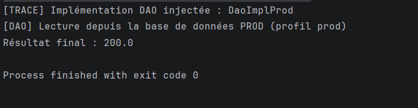

# Captures d'Écran du TP : Inversion de Contrôle (IoC) & Principe OCP

---

## 1. Ambiguïté initiale : `NoUniqueBeanDefinitionException`

### Ce que montre cette capture :
- **L'erreur obtenue** : Spring détecte 4 implémentations de l'interface `IDao` (`dao`, `dao2`, `daoFile`, `daoApi`) et refuse de démarrer car il ne sait pas laquelle injecter dans `MetierImpl`.
- **Ce qui a été fait** : Démarrage du conteneur Spring sans aucune règle de priorité. C'est l'illustration du problème d'ambiguïté initial à résoudre.

---

## 2. Stratégie A : Utilisation de `@Primary`

### Ce que montre cette capture :
- **La sortie console** : 
  - `[TRACE] Implémentation DAO injectée : DaoImpl`
  - `[DAO] Lecture depuis la base de données (prod) - PRIMARY`
  - `Résultat final : 200.0`
- **Ce qui a été fait** : Ajout de l'annotation `@Primary` sur la classe `DaoImpl`. Spring l'a sélectionnée par défaut parmi les 4 candidats, et le calcul métier a donné `100.0 * 2 = 200.0`.

---

## 3. Stratégie B : Pointeur dynamique via `@Bean`

### Ce que montre cette capture :
- **La sortie console** : 
  - `[TRACE] Implémentation DAO injectée : DaoApi`
  - `[DAO] Appel à l'API REST externe`
  - `Résultat final : 440.0`
- **Ce qui a été fait** : Création d'une classe de configuration `DaoAliasConfig` avec une méthode `@Bean` retournant `new DaoApi()`. Spring injecte l'API externe sans toucher au code de `MetierImpl`. Le calcul métier a donné `220.0 * 2 = 440.0`.

---

## 4. Stratégie C : Sélection dynamique via `app.properties`

### Ce que montre cette capture :
- **La sortie console** : 
  - `[TRACE] Implémentation DAO injectée : DaoImpl2`
  - `[DAO] Lecture depuis la base de données (dev)`
  - `Résultat final : 300.0`
- **Ce qui a été fait** : Définition de la propriété `dao.target=dao2` dans le fichier `app.properties`. Spring a lu cette clé et instancié dynamiquement `DaoImpl2` sans modifier ni recompiler une seule ligne de code Java. Le calcul métier a donné `150.0 * 2 = 300.0`.

---

## 5. Test de non-régression avec JUnit

### Ce que montre cette capture :
- **La sortie console / IDE** : 
  - Exécution du test `OcpSelectionTest`
  - `Tests run: 1, Failures: 0, Errors: 0, Skipped: 0`
  - `BUILD SUCCESS` (barre verte)
- **Ce qui a été fait** : Lancement du test automatisé JUnit qui valide que `MetierImpl` respecte le principe OCP et produit bien le résultat attendu selon la configuration active.
